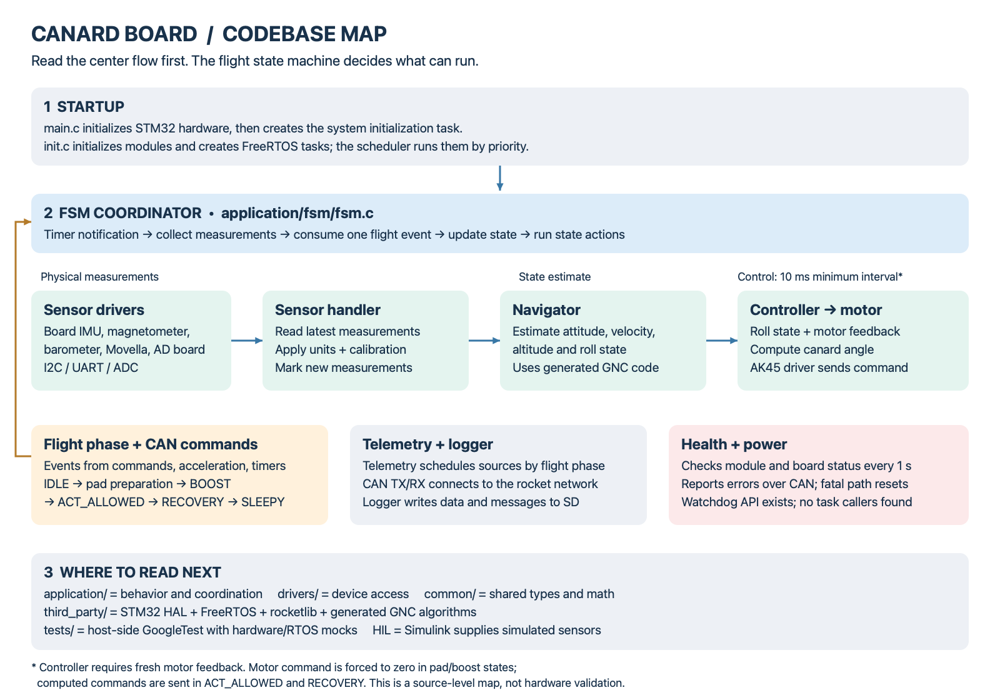

# Reading the canard board firmware

This is STM32 flight firmware for Waterloo Rocketry's canard system. Its main job is to estimate how the rocket is moving and calculate a canard angle for roll control. FreeRTOS lets the flight loop, sensor acquisition, CAN communication, logging, and health monitoring share the processor.

## The main story

1. **Start the board.** `src/main.c` configures the microcontroller's clocks and peripherals. Its handoff to application code is `init_tasks()`.
2. **Initialize the application.** `src/application/init/init.c` creates a system initialization task, initializes drivers and application modules, then creates the runtime tasks. It distinguishes critical from noncritical initialization failures. Critical failures enter the fatal error handler. The initialization task later handles the blinking LED and motor calibration requests.
3. **Collect measurements.** Drivers read the board IMU, magnetometer, barometer, Movella sensor, AD sensor board, and motor feedback. Some drivers have their own tasks. The sensor handler collects data, applies calibration and coordinate rotations, converts units, and marks measurements as new.
4. **Decide the flight phase.** The FSM task asks the flight phase module to generate events, consumes one queued event, and updates the current state. Events come from CAN commands, acceleration detection, and elapsed time.
5. **Estimate motion.** The navigator turns measurements into an estimated attitude, angular rate, velocity, altitude, roll state, and dynamic pressure. The C wrapper calls generated GNC algorithms under `src/third_party/closedrocket/`.
6. **Calculate and apply control.** The controller uses estimated roll, dynamic pressure, flight time, and measured motor position to calculate a canard angle. The FSM decides whether to send that angle to the AK45 motor.
7. **Report what happened.** Telemetry invokes registered callbacks at rates chosen for the current flight phase. CAN carries commands and status/data messages. Logging records text and structured data to SD. Health checks poll module and board status once per second.

The navigator and controller are called by the FSM task; they are not independent runtime tasks in this checkout. Queues, latest-value mailboxes, callbacks, and task notifications connect the concurrent parts.

## The state machine in plain language

| State | What the FSM does |
|---|---|
| `IDLE` | Seeds sensor filters and keeps navigator/controller timestamps current. |
| `PAD_FILTER` | Runs estimation and, when eligible, controller calculations; sends zero motor position. |
| `PAD_NAV` | Runs estimation and eligible controller calculations; sends zero motor position. |
| `BOOST` | Runs estimation and eligible controller calculations; sends zero motor position. |
| `ACT_ALLOWED` | Runs estimation and sends computed motor positions when the controller runs. |
| `RECOVERY` | Also runs estimation and sends computed motor positions when the controller runs. |
| `SLEEPY` | Continues estimation, stops issuing motor commands in this branch, and requests external 5 V off. |
| `ERROR` | Exists in the enum; `fsm_exec()` handles it through the default unknown-state branch. |

The usual route is `IDLE → PAD_FILTER → PAD_NAV → BOOST → ACT_ALLOWED → RECOVERY → SLEEPY`. Launch acceleration or an injector-open event can also move directly from `PAD_FILTER` to `BOOST`, skipping `PAD_NAV`.

The controller has a minimum interval of 10 ms (100 Hz when inputs and scheduling allow) and requires fresh motor feedback. Avoid assuming every loop invokes every algorithm. FSM timing comments are inconsistent: `fsm.h` says 500 Hz, while other modules contain older timing assumptions. The actual interrupt rate depends on TIM5 and its clock configuration; establish that from hardware configuration before relying on a quoted frequency.

## How the folders fit together

| Folder/file | Purpose | Reading priority |
|---|---|---|
| `src/application/` | Flight behavior and coordination | Start here |
| `src/common/gnc/gnc_types.h` | Flight state enum and shared sensor/navigation/control data | Read early |
| `src/drivers/` | Sensor, motor, bus, timer, storage, and GPIO interfaces | Follow a particular sensor or output |
| `src/third_party/closedrocket/` | GNC models and generated numerical code | After understanding the C wrappers |
| `src/third_party/cubemx_autogen/` | Generated peripheral setup, HAL, FreeRTOS, and middleware | Consult for hardware/timing questions |
| `src/third_party/rocketlib/` | Shared team code, including CAN support | Follow protocol/helper calls here |
| `Inc/`, `*.ioc`, `*.ld` | Hardware headers, CubeMX configurations, linker memory layout | Hardware reference |
| `platformio.ini` | Firmware build variants for board/sensor configurations, debug/release, and HIL | Check before building/flashing |
| `tests/` | Host-side GoogleTest and Fake Function Framework mocks | Read alongside modules |
| `scripts/` | Developer utilities, including log parsing | Useful when investigating recorded flights |

## Your open file: health_checks.c

Think of this module as a periodic inspector, with three inputs:

- **Task watchdog:** a task registers its handle and timeout with `watchdog_register_task()`, then calls `watchdog_kick()` as it makes progress. The kick identifies the current task and updates its timestamp. `check_watchdog_tasks()` reports overdue tasks over CAN.
- **Module health:** a table maps module IDs to `*_get_status()` functions. Non-OK statuses are logged and sent over CAN. Fatal module statuses enter `proc_handle_fatal_error()`.
- **Board health:** `power_handler_get_board_status()` contributes board-level status bits.

`health_check_exec()` combines those results and transmits a general board status message. `health_check_task()` runs it every 1,000 ms. This watchdog is software bookkeeping; the timeout branch reports a fault rather than directly resetting the board. The separate fatal handler attempts error transmission and a system reset.

**Important current limitation:** searching the source finds watchdog registration/kick declarations and definitions, but no callers. `health_check_init()` sets the registered task count to zero. Consequently, the task-watchdog loop has no tasks to inspect in this checkout, even though module and board checks still run.

The watchdog also accepts a kick since the preceding inspection as sufficient, even if its timestamp is now older than the configured timeout. With inspections only once per second, it should not be interpreted as a precise deadline monitor.

## High-level review

The separation between application coordination, device drivers, and generated algorithms makes the project approachable. Shared context/input/output types make the estimator-to-controller handoff explicit. The centralized telemetry registry and module health interface provide common patterns to follow across modules. HIL adds a way to exercise the flight logic using Simulink sensor inputs and return calculated outputs.

The main areas to read carefully are:

- **Monitoring integration:** the task watchdog is currently unwired, and its test target is commented out in `tests/CMakeLists.txt`.
- **Control and failure behavior:** `fsm_exec()` does not check several return values, including navigator/controller steps and motor sends. Read those callees and their health reporting before assuming the loop reacts immediately to a failed calculation or transmission.
- **State names versus actions:** `RECOVERY` still sends computed motor commands. Read the state actions and transition triggers rather than inferring behavior from names.
- **Verification gaps:** the configured host tests cover numerous drivers and application helpers, but there are no active dedicated FSM, navigator, or controller test groups in the inspected test configuration. A TODO explicitly calls for FSM tests.
- **Comments versus implementation:** task rates, priority/stack sizing TODOs, and the startup delay workaround indicate places where intent and measured behavior need to be checked separately.

These are source-reading observations, not a completed flight-safety audit. No firmware was changed, compiled, flashed, or run on hardware for this overview.

## Suggested reading order

1. `src/common/gnc/gnc_types.h`: learn the vocabulary and data shapes.
2. `src/application/init/init.c`: see which modules and tasks exist.
3. `src/application/fsm/fsm.c`: read `fsm_task()` first, then `fsm_exec()`.
4. `src/application/flight_phase/flight_phase.c`: read transitions and event generation.
5. `src/application/sensor_handler/sensor_handler.c`: follow `sensor_handler_get_fresh_meas()`.
6. `src/application/navigator/navigator.c` and `controller/controller.c`: follow `navigator_step()` and `controller_step()` into generated code only as needed.
7. `src/application/health_checks/health_checks.c`, `telemetry/telemetry.c`, and `logger/log.c`: learn observation and fault reporting.
8. Pick one device driver and its unit test, then trace one measurement all the way to a motor command or log record.

A useful first exercise is to trace **motor encoder measurement → controller input → commanded canard angle → radians-to-degrees conversion → `ak45_send_position_cmd()`** in the FSM.
